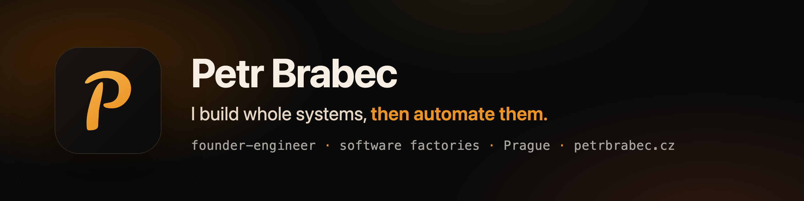

Founder-engineer from Prague. Coding since 14, today building **software factories** where teams and fleets of AI agents ship real products together.

### Now

- **[Upskill](https://www.connectupskill.com)** · co-founder, CTO. Helping students and fresh graduates land their first internship.
- **[finshape](https://finshape.com)** · building AI software factories: the layer that lets teams build banking products with fleets of AI agents.

### What I bring

- **Build the whole product, end to end.** From the first commit to a running business.
- **Make a team AI-native.** People and AI agents working together, from code to customers.
- **Turn manual work into systems.** Processes people repeat by hand become agents and tools.

### Built in the open

<table>
<tr>
<td width="50%" valign="top">

<b><a href="https://github.com/PetrBrabec/t3-code-pad">t3-code-pad</a></b> 
A better T3 Code. Read, quote and answer your coding agents with a DualSense, a Switch controller or just the keyboard.
</td>
<td width="50%" valign="top">
<b><a href="https://github.com/PetrBrabec/todoist-mcp">todoist-mcp</a></b> 
An MCP server that gives LLMs your Todoist.
</td>
</tr>
</table>

### How I got here

**finshape** 2024 · **Upskill** 2023, co-founder, CTO · **strafos, EPAM, AlgOps, 4finance** 2019 to 2023 · **Daytrip** 2015 to 2019, co-founder, CTO at 19 · **First lines** 2010 to 2015

The full story, with the teams and the numbers: **[petrbrabec.cz](https://petrbrabec.cz)**

[Website](https://petrbrabec.cz) · [LinkedIn](https://www.linkedin.com/in/petrbrabeccz) · [X](https://x.com/petrbrabeccz) · [Telegram](https://t.me/petrbrabec) · [Email](mailto:mail@petrbrabec.cz)
